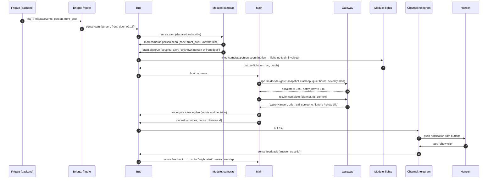

# Architecture

The system is a small, hand-written **host** and a growing set of generated **modules**. This
document describes the host one component at a time: what each one owns, what it listens to, what
it publishes or answers, and its status. Cross-cutting rules that every component must follow come
after. For the why, see [VISION.md](VISION.md).

Status legend: **exists**, **extend** (exists, needs new behaviour), **new**.

---

## Overview: the layers

Seven layers. Everything in the middle five talks only through the bus. Arrows at the edges are the
only places where something other than a bus message crosses a boundary (a phone, a camera, a
Docker socket, a model API).

```
╔══════════════════════════════════════════════════════════════════════════════════════════════════╗
║ HANSEN                                        WORLD                                              ║
║ phone · browser · voice                       devices · cameras · screen · mic · cloud accounts  ║
╚═══════════╤═════════════════════════════════════════════════════╤════════════════════════════════╝
            │ messages, taps, speech                              │ states, frames, audio, mail
╔═══════════▼═════════════════════════════════════════════════════▼════════════════════════════════╗
║ CHANNELS   talk with Hansen                       BRIDGES   sense and act on the world           ║
║ telegram · web app · voice                        home assistant · frigate · screen · ambient    ║
║ line · whatsapp · ...                             connectors: gmail · calendar · drive · notion  ║
╚═════╤═════════════════════════════════▲═══════════════════╤═════════════════════════▲════════════╝
      │ sense.chat                      │ out.notify        │ sense.iot · sense.cam   │ out.ha
      │ sense.feedback                  │ out.say           │ sense.screen · mail     │ out.mail
      ▼                                 │ out.ask           ▼ sense.calendar · files  │ out.calendar
╔═══════════════════════════════════════╧═════════════════════════════════════════════╧════════════╗
║ BUS   NATS + JetStream                                                                           ║
║ EVENTS stream   sense.* brain.* mod.* sys.* build.* out.* trace.*         stored, replayable     ║
║ requests        rpc.sys.* rpc.mod.* rpc.memory.* rpc.llm.*                never stored           ║
║ KV              snapshot cache · dedupe ids · pending approvals · rate counters                  ║
╚═══════╤══════════════╤══════════════╤══════════════╤══════════════╤══════════════╤═══════════╤═══╝
        │              │              │              │              │              │           │
╔═══════▼══════════════▼══════════════▼══════════════▼══════════════▼══════════════▼═══════════╪═══╗
║ HOST   hand-written once, stays small                                                        │   ║
║ ┌────────────┐ ┌────────────┐ ┌────────────┐ ┌────────────┐ ┌────────────┐ ┌────────────┐    │   ║
║ │ GATEWAY    │ │ MAIN       │ │ MEMORY     │ │ BUILDER    │ │ SUPERVISOR │ │ TRACER     │    │   ║
║ │ rpc.llm.*  │ │ gate       │ │ vault      │ │ new        │ │ deploy     │ │ events     │    │   ║
║ │ budget     │ │ planner    │ │ index      │ │ change     │ │ catalog    │ │ traces     │    │   ║
║ │ cost log   │ │ ladder     │ │ summaries  │ │ wrap       │ │ secrets    │ │ owns stream│    │   ║
║ │ shadow     │ │ snapshot   │ │ embed      │ │ verify     │ │ rollback   │ │            │    │   ║
║ │ keys ●     │ │ policy     │ │ recall     │ │ coder ●    │ │ docker ●   │ │            │    │   ║
║ └────────────┘ └────────────┘ └────────────┘ └────────────┘ └────────────┘ └────────────┘    │   ║
╚═══════╤════════════════════════════════════════════╤══════════════╤══════════════════════════╪═══╝
        │                                            │ writes code  │ builds · runs   declared │
        │                                            │              │ provisions    subscribes │
╔═══════╪════════════════════════════════════════════▼══════════════▼══════════════════════════▼═══╗
║       │   MODULES   generated on demand, the only part that grows (these three are examples)     ║
║       │   ┌──────────────┐  ┌──────────────┐  ┌──────────────┬─────────────┐  each one:          ║
║       │   │ hello        │  │ expenses     │  │ cameras      │ frigate     │  own container      ║
║       │   │ sqlite       │  │ postgres     │  │ (wrapper)    │ (backend,   │  own database       ║
║       │   │              │  │              │  │              │  pinned)    │  declared events    ║
║       │   └──────────────┘  └──────────────┘  └──────────────┴─────────────┘  → mod.<name>.*     ║
║       │                                                                       → brain.observe    ║
║       │                                                                       ← rpc.mod.<name>.* ║
╚═══════╪══════════════════════════════════════════════════════════════════════════════════════════╝
        │
╔═══════▼══════════════════════════════════════════════════════════════════════════════════════════╗
║ MODELS   slots with swappable providers (providers.yaml); active acts, shadow only logs          ║
║ gate: Jev ☁             planner: Claude API ☁ | vLLM / Ollama (GPU 0)                            ║
║ coder: Claude Code ☁ | Aider / OpenHands (local)      embed · vision · stt · tts: local, GPU 1   ║
╚══════════════════════════════════════════════════════════════════════════════════════════════════╝
╔══════════════════════════════════════════════════════════════════════════════════════════════════╗
║ INFRA   postgres, one db per owner · volumes, /data per owner · secrets/ · nightly backups       ║
║ docker networks: bus | data | backend-<module> | egress | lan · caddy · tailscale                ║
╚══════════════════════════════════════════════════════════════════════════════════════════════════╝

 ●  the only places that hold something other than bus access: keys = API tokens,
    coder = Agent SDK, docker = the socket.   ☁ = leaves the box, text only.
    raw pixels, audio and attachments become text at the edge; they never cross the bus.
```

---

## Full diagram: components and connections

Renders on GitHub. Solid arrows are stored events, dashed arrows are request/reply, thick arrows
are not bus traffic at all.

```mermaid
flowchart TB
    classDef exists fill:#dfe9d5,stroke:#4a6a2e,color:#1e2d12
    classDef extend fill:#fbe8c3,stroke:#9a6a12,color:#3d2a05
    classDef new fill:#e4e0f5,stroke:#5b4a9c,color:#231b45
    classDef gen fill:#f3f3f3,stroke:#777,color:#222,stroke-dasharray: 4 3
    classDef ext fill:#ffffff,stroke:#999,color:#444

    H(["Hansen<br/>phone · browser · voice"]):::ext
    W(["World<br/>devices · cameras · screen · mic · cloud accounts"]):::ext

    subgraph EDGE["Edge adapters, hand-written"]
        direction LR
        CH["Channels<br/>telegram ✓ · web app · voice · line / whatsapp"]:::extend
        BR["Bridges<br/>home assistant · frigate · screen · ambient audio<br/>connectors: gmail · calendar · drive · notion"]:::new
    end

    BUS[["NATS + JetStream<br/>EVENTS stream · rpc · KV"]]:::exists

    subgraph HOST["Host services"]
        direction LR
        MAIN["Main<br/>gate · planner · ladder<br/>snapshot · policy"]:::new
        MEM["Memory<br/>vault · index · summaries<br/>embeddings · recall"]:::new
        BLD["Builder<br/>new · change · wrap<br/>verify · coder slot"]:::extend
        SUP["Supervisor<br/>deploy · catalog · secrets<br/>backends · rollback"]:::extend
        TR["Tracer<br/>events · traces · stream owner"]:::extend
        GW["Model gateway<br/>rpc.llm.* · budget · cost log · shadow"]:::new
    end

    subgraph MODS["Modules, generated on demand (examples)"]
        direction LR
        M1["hello<br/>sqlite"]:::gen
        M2["expenses<br/>postgres"]:::gen
        M3["cameras wrapper<br/>+ frigate backend"]:::gen
    end

    subgraph MODELS["Model providers"]
        direction LR
        JEV["Jev ☁"]:::ext
        CL["Claude API ☁"]:::ext
        LOC["vLLM / Ollama<br/>GPU 0"]:::ext
        PER["whisper · piper · VLM · embed<br/>GPU 1"]:::ext
        CC["Claude Code ☁<br/>Aider / OpenHands"]:::ext
    end

    subgraph INFRA["Infrastructure"]
        direction LR
        PG[("Postgres<br/>one db per owner")]:::exists
        VOL[("volumes<br/>/data per owner")]:::exists
        DK["Docker<br/>networks: bus · data · backend · egress · lan"]:::exists
        SEC["secrets/"]:::new
    end

    H <==> CH
    W <==> BR

    CH -->|"sense.chat · sense.feedback"| BUS
    BUS -->|"out.notify · out.say · out.ask · out.progress"| CH
    BR -->|"sense.iot · sense.cam · sense.screen · sense.voice · sense.mail · sense.calendar · sense.files"| BUS
    BUS -->|"out.ha · out.mail · out.calendar"| BR
    BUS -.->|"rpc.connect.*"| BR

    BUS -->|"sense.* · brain.observe · sys.* · build.*"| MAIN
    MAIN -->|"out.* · trace.*"| BUS
    MAIN -.->|"rpc.mod.* · rpc.memory.* · rpc.sys.catalog · rpc.llm.* · rpc.build.start"| BUS

    BUS -.->|"rpc.memory.*"| MEM
    MEM -.->|"rpc.llm.embed"| BUS

    BUS -.->|"rpc.build.*"| BLD
    BLD -->|"build.started / stage / progress / done / failed"| BUS
    BLD -.->|"rpc.sys.verify · rpc.sys.snapshot · rpc.sys.deploy · rpc.llm.complete"| BUS

    BUS -.->|"rpc.sys.*"| SUP
    SUP -->|"sys.module.*"| BUS

    BUS -->|"everything, from the stream"| TR
    BUS -.->|"rpc.llm.*"| GW

    BUS -->|"declared subscribes"| MODS
    MODS -->|"mod.name.* · brain.observe"| BUS
    BUS -.->|"rpc.mod.name.*"| MODS
    MODS -.->|"rpc.llm.* optional"| BUS

    GW ==> JEV
    GW ==> CL
    GW ==> LOC
    GW ==> PER
    BLD ==>|"Agent SDK"| CC
    BLD ==>|"writes modules/name/"| MODS
    SUP ==>|"socket: build · run · provision"| DK
    DK ==> MODS
    SUP ==> SEC
    GW ==> SEC

    TR ==> PG
    MEM ==>|"own db + read-only events"| PG
    MAIN ==>|"own db"| PG
    GW ==>|"own db"| PG
    MODS ==>|"own db or sqlite file"| PG
    MODS ==> VOL
    MEM ==>|"vault files"| VOL
```



---

## Connections, one row each

| From | To | Subject / path | Kind | Carries |
|---|---|---|---|---|
| Channel | bus | `sense.chat` | event | `{channel, thread, text}` |
| Channel | bus | `sense.feedback` | event | 👍/👎 or an approval answer, with the trace it belongs to |
| Main | channel | `out.notify`, `out.say` | event | a message; policy picks the channel |
| Main | channel | `out.ask` | event | a question with choices; answer returns as `sense.feedback` |
| Main | channel | `out.progress` | event | a job Hansen waits on (a build he approved), one message per `ref` that changes in place: title, steps, plain text |
| Bridge | bus | `sense.iot`, `sense.cam`, `sense.screen`, `sense.voice` | event | text summaries only |
| Connector | bus | `sense.mail`, `sense.calendar`, `sense.files` | event | metadata and a text summary per new item; bodies and attachments stay in the connector's own db and blobs |
| Main / module | connector | `rpc.connect.<service>.<action>` | request | on-demand reads: search mail, list events, find a file, fetch one body |
| Main / module | bridge | `out.ha` | event | a Home Assistant service call (actuation, gated) |
| Main / module | connector | `out.mail`, `out.calendar` | event | send a mail, create an event (actuation; mail to other people never becomes automatic) |
| Module | bus | `mod.<name>.<event>` | event | declared payload, validated by the SDK |
| Module | Main | `brain.observe` | event | `{type, summary, severity, data}` |
| Main / module | module | `rpc.mod.<name>.<action>` | request | declared params → declared returns |
| Main | memory | `rpc.memory.recall / remember / lookup` | request | notes, summaries, fuzzy matches |
| Main, memory, bridges, modules | gateway | `rpc.llm.complete / embed / decide / transcribe` | request | prompt → completion; keys never leave the gateway |
| Main | builder | `rpc.build.start` | request | `{name, spec, coder?}` after Hansen approved the spec, or `{name, change, coder?}` after he approved a change to a grown module; answers `{build_id, position}` or why not |
| Builder | bus | `build.started / stage / progress / done / failed` | event | each step as it begins, each round as it ends (in a line), then the commit or where it stopped; all with the thread that asked |
| Builder | gateway | `rpc.llm.complete` (slot `coder`) | request | our coder: one forced tool call per file, `cause` = the build id |
| Builder | supervisor | `rpc.sys.verify` | request | the staged build's tests in the sealed container |
| Builder | supervisor | `rpc.sys.snapshot` | request | a change build: a copy of the module's data volume before the new version deploys |
| Builder | supervisor | `rpc.sys.agent` | request | a coding agent's round on a copy of the staged build; the folder comes back |
| Builder | supervisor | `rpc.sys.catalog` | request | what already exists, so the new module can subscribe to other modules' events and reuse their requests |
| Builder | supervisor | `rpc.sys.deploy` | request | deploy the verified module |
| Anyone | supervisor | `rpc.sys.list / health / logs / stop / catalog / rollback` | request | registry, catalog of all declared events and requests |
| Supervisor | bus | `sys.module.deployed / stopped / failed` | event | lifecycle |
| Main | bus | `trace.gate / plan / notify` | event | decision + inputs, for "why?" and evals |
| Tracer | Postgres | — | thick | every stored event → `events`, every trace → `traces` |
| Memory | Postgres | — | thick | own db; `events` read-only |
| Supervisor | Docker | socket | thick | build images, run containers, networks, volumes, provision databases |
| Builder | filesystem | `GROWN_DIR/.staging/<name>/`, then `GROWN_DIR/<name>/` | thick | generated code, never run by the builder; one git commit per build |
| Gateway | providers | HTTPS / local HTTP | thick | the only path text takes off the box |

---

## One event end to end

Someone at the door at 02:13. The `cause` field links every hop, so the trace viewer can show this
chain for any notification.



Every message in that chain is in `events`, every decision in `traces`, and the lights module never
knew Main existed.

---

## 1. Bus — NATS + JetStream — exists

The only way anything talks to anything.

| | |
|---|---|
| Events (stored) | `sense.*`, `brain.*`, `mod.*`, `sys.*`, `build.*`, `out.*`, `trace.*` |
| Requests (not stored) | `rpc.sys.*`, `rpc.mod.<module>.*`, `rpc.memory.*` |
| Rule | Events by default. A request only when the caller needs an answer back. `rpc.*` is never in the stream. |
| Logins | Two (`services/nats/nats.conf`). `core`: the services and mctl, everything. `module`: the only login a module gets (the supervisor's `MODULE_NATS_URL`), exactly what the SDK's `Module` does: publish `mod.>`, `brain.observe`, `sys.module.started`; answer its own requests; listen to `sense.*`, `brain.*`, `mod.*`, `sys.*`, `build.*`, `out.*`. No `rpc.*` request of any kind, no `trace.*`, no `stream.*`, no JetStream. So a module, generated or not, cannot deploy, start a build, run a coding agent, call a model or read memory. The supervisor refuses to start if `MODULE_NATS_URL` has the core login. Not yet: one login per module (a module can still emit another's events or answer another's requests). |
| MQTT | NATS can serve as an MQTT broker. Frigate, Home Assistant and most devices can publish straight onto the bus; a bridge renames their subjects to `sense.*`. |

---

## 2. Tracer — exists

The black-box recorder. Writes every bus message to Postgres `events` and every decision to
`traces`. Owns the JetStream `EVENTS` stream.

| | |
|---|---|
| Owns | `events` (raw log, source of truth), `traces` (decisions with inputs and 👍/👎) |
| Listens | everything |
| Answers | nothing (reads go straight to Postgres, later through memory) |
| Extend | read from the stream instead of a live subscription so the log has no holes; retention tiers (§ Cross-cutting) |

---

## 3. Supervisor — extend

The only service with Docker access. Turns a module folder into a running container.

| | |
|---|---|
| Owns | `modules` table (deployed manifests, status), images, per-module volumes |
| Answers | `rpc.sys.deploy / verify / snapshot / stop / logs / list / health` |
| Publishes | `sys.module.deployed / stopped / failed` |
| Extend: **catalog** | `rpc.sys.catalog`: every deployed module's events, requests and their fields, plus the static core subjects (`sense.*`, `out.*`). Built from the manifests already stored; nothing kept by hand. |
| Extend: **compat check** | Refuse a deploy that changes an event other modules subscribe to in a non-additive way. |
| Extend: **secrets** | Inject declared secrets from a local store at container start. |
| Extend: **backends** | Start a pinned third-party container next to a module that wraps it; only those two share a network. |
| Extend: **rollback** | Keep the previous image and a `/data` snapshot; `rpc.sys.rollback <module>`. The snapshot is built (`rpc.sys.snapshot`, taken before every change build deploys) and the previous version is tagged in `GROWN_DIR`; the one call that puts both back is not. |

*Built:* modules come from two roots: `MODULES_DIR` (hand-written: `hello`) and `GROWN_DIR` (the grown
modules' own git repo, which the builder writes); a name in both is refused. **`rpc.sys.verify`** builds a
module's image as `:verify` and runs its tests in a throwaway container with no network, no environment
beyond `TZ`, a read-only filesystem with a small `/tmp`, no capabilities and bounded memory and processes,
then removes it. That is the builder's independent check and the only place generated code runs before it
is deployed. A build is staged in `GROWN_DIR/.staging/<name>` (never a valid module name, so never deployed)
until verify passes. Every module gets `TZ` from `MODULE_TZ`, so `mod.today()` is Hansen's day. Reconcile
never retires modules because a whole root is missing (a `GROWN_DIR` without `.git` counts as missing).
`rpc.sys.list` names the folders in `GROWN_DIR` apart (`grown`): those are the modules the builder can
change. **`rpc.sys.snapshot`** copies a module's data volume to `<stack>-data-<name>-v<version>-<build id>`
before a change build deploys: a throwaway module-base container with no network, the module paused while it
copies (so the copy is what a crash would leave, which SQLite recovers from), and no copy kept if it fails.

**Coding agents** run here too, because only the supervisor holds Docker (`rpc.sys.agent`, `rpc.sys.agents`;
recipes in `services/supervisor/agent_images/agents.yaml`, an image per agent FROM module-base so the agent can run
the module's tests). Each run is a container on a copy of the staged build: the folder at `/work/module`, the
task at `/work/PROMPT.md`, only the variables its recipe maps (its model's address, its key), not root, no
capabilities, bounded memory and processes, on Docker's default bridge network (its model and the internet,
never the mesh). What comes back is the folder as the agent left it, small text files only (512 KB in all, so
the reply fits one NATS message; what is left out is named, never taken for deleted), with key values
redacted; the builder takes from it only what a coder may write. Each agent's image is built once per
supervisor start, and verify or agent containers a restart left behind are removed on start. Neither kind
carries a module's labels, so `rpc.sys.list` and `health` never show them. Agent spend is outside the
gateway's budget.

---

## 4. Modules — the generated part

Everything the system grows. One container each, one job each, contract in `template/CONTRACT.md`.

| | |
|---|---|
| Owns | its own data in `/data` (SQLite), its handlers, its tests, later its UI panel |
| Listens | declared `subscribes` |
| Publishes | `mod.<name>.<event>` (declared), `brain.observe` summaries |
| Answers | `rpc.mod.<name>.<action>` (declared), `health` automatic |
| Kinds | **plain** (re-created from scratch), **wrap** (thin module + backend container running open software), **bridge** (hand-written host adapter, e.g. Home Assistant → `sense.iot`) |

**Where modules live.** Nothing is pre-built; a module exists only after Hansen asked for it. Once
built it is real code that has to persist and have history (change builds, rollback), so generated
modules go in their **own git repo**, `GROWN_DIR` (`./grown` locally, `~/mycelium-grown/<stack>` on a
deployed box), mounted by the supervisor (read-only) and the builder. The builder makes one commit per
build (`expenses v0.1.0`, tagged `expenses-v0.1.0`); that commit is the rollback point. This host repo
keeps only `template/` and the hand-written reference module `hello` in `modules/` (the smoke test and
the example every coder is shown), so the public repo never holds Hansen's grown software and
`make test` does not depend on what the system has built.

**Described requests: built.** A manifest's `requests` may be described (below, with `optional <type>` for a
field that may be left out, since YAML refuses `{day?: date}`). The SDK keeps the names in `requests`, so every
reader of them is unchanged, and the descriptions in `request_specs`; the supervisor stores the manifest in its
`modules` table and serves it on `rpc.sys.list`, and Main's prompt shows each request with its fields
(`expenses.add {amount: number, day: optional date}: Store one expense.`), so it calls a module from what the
module says rather than guessing. A grown module must describe every request: the builder's manifest check
fails the round otherwise. `hello` is described the same way, as the example every coder reads. **Still to
come:** described `emits` with payloads checked by the SDK, `storage`, and `rpc.sys.catalog` (today
`rpc.sys.list` carries the same manifests).

The design, with events described too:

```yaml
emits:
  expense.logged:
    description: An expense was recorded.
    payload: {amount: number, currency: string, category: string?}
requests:
  total:
    description: Total spent in a date range.
    params: {from: date, to: date}
    returns: {total: number, currency: string}
storage: sqlite        # or postgres: the supervisor provisions a private database (§12)
secrets: []            # names injected by the supervisor, approved by Hansen
backend: null          # image@version of wrapped open software, if any
permissions:
  network: false
  actuation: false
  devices: []          # later: camera, gpu
```

The SDK validates every emitted payload against its declaration, the same way it refuses
undeclared events today.

---

## 5. Main — v0 built (the chat path)

The judgment. Everything that decides, nothing that stores.

**v0** (`services/main/`): `sense.chat` → recall pack from memory + the thread from NATS KV → planner
through the gateway with seven tools (`remember`, `recall`, `ask_module`, `show`, `ask`, `propose_module`,
`change_module`) →
`out.say`, or `out.ask` when the planner needs Hansen's choice → one `trace.plan` with the pack, the
tool calls, usage and cost, linked by `cause`. `sense.feedback` answers continue the thread; votes are
traced. When the gateway fails or the budget is spent, Main still replies that it cannot reach its model
and keeps the turn. The module list in the prompt says what each module listens to, so the planner knows
a module on `sense.chat` already hears "dinner 350". Not yet: the gate, the state snapshot, the policy
database; `brain.observe` is only logged.

**Saying only what it did.** The thread Main reads back is what happened, not only what was said: each
assistant turn keeps the tool calls Main accepted in it (arguments and the start of each result), and the
planner reads them again as tool_use / tool_result before that turn's reply. With replies alone ("Logged:
152") a model learns to write the words without the call. Each of Hansen's earlier messages starts with its
date in Main's time zone, so a "today" in an old message, or a date an old reply mentions, is read as that day.
A reply that still says something was saved, logged or noted when no `remember` went through in the turn,
and names no module that hears the chat (one may have logged it itself), is not sent: Main asks the planner
once more, and it either calls `remember` or says it plainly. The trace marks such a turn (`claim_check`).

**Showing a module's data.** When a module's answer is something to see rather than read (its entries, totals
by category or by day, a few figures, one record, a number against a goal), the planner calls `show` after
`ask_module`: a **table** (sortable; a card per row in a narrow chat), a **chart** (bars ranked largest first,
or a line or area over time, up to four series, each with its table view), **stats**, **details** or a
**meter**, sent with the reply as `blocks` on `out.say` / `out.ask` (`services/main/blocks.py`). `show` names
the request it called this turn and where in the reply the data is; Main builds the block from the module's own
reply, so no number on screen was written by the model, and tells the planner what it showed so the reply says
what it means instead of repeating it. Main formats every value once (money in `MAIN_CURRENCY`, dates in its
zone) and sends each as data and as it reads; the web app places them, Telegram gets each block's monospace
text as its own message after the reply, and `mctl chat` prints it.

**Growing a module.** When Hansen wants something ongoing that no module does ("track my expenses"),
or logs something no module tracks ("spent 85 on breakfast": remembered first, since a proposal ends the
turn), the planner calls `propose_module` with the parts of a spec (name, purpose, need, behaviour, answers
with their fields, example); code renders `SPEC.md` in the format of `specs/expenses.md` and checks the name
against the SDK's rules, `rpc.sys.list` and the running builds. A module that tracks entries gets an `add`
taking one entry, and queries over all time by default: Main reads Hansen's messages and sends each entry to
`add` (`ask_module`), so the module never parses chat with a pattern of its own (the first grown `expenses`
did, and missed "today i spend 112 for dinner"). A valid proposal ends the turn like `ask`: Main
stores it in its KV (`proposals.py`, keyed by the card's id) and only then sends the card, Build it /
Not now. The tap is handled in code, never by the model: under the thread's lock Main re-reads the
proposal (a second tap or an old card finds it decided), calls `rpc.build.start` with the channel and
thread, and says what happened. A start that gets no answer in time is not taken as "nothing started":
Main looks for a build of that name from that thread in `rpc.build.list` and follows it if it is there,
and a `build.done/failed` that arrives for it later is still matched by name and thread. A builder that is
down or refuses (busy, name taken, coder not ready) is said as it is, on a fresh card for the same
proposal, since the apps take the buttons off a card once it is answered. `build.done` and
`build.failed` carry the channel and thread back; Main tells that thread, once. On start it asks
`rpc.build.get` about proposals still building, for builds that ended while it was down, and tries again
every 30 s until the builder answers (compose starts them together). The builder's contract is the SDK's
(`mycelium_sdk.build`): `rpc.build.start / get`, the build record and every `build.*` event, so Main reads each
event with the model the builder made it with, and an event that does not read is logged and left alone. The prompt lists the latest proposals
that are not running modules (waiting, building, declined, failed), so the planner does not offer the same
module again while one waits or after Hansen chose Not now.

    proposed -> building -> done | failed
             -> declined

**Changing a module.** A module the builder grew is marked `(grown, v0.1.0)` in the prompt's module list.
When Hansen says it does something wrong, misses something, or should work differently ("the summary never
counts yesterday", "keep a category too"), the planner calls `change_module` with the module, what it should
do after the change (one line each) and why; `propose_module` for a name that exists now says to change it
instead. Code refuses a module that is hand-written, gone, or being built. A valid change is a proposal of
kind `change` and ends the turn the same way, with a card, Change it / Not now, that says the module keeps
its data; a tap calls `rpc.build.start` with `change` instead of `spec`. Main tells the thread when the new
version runs, or that the change failed and, unless it failed at deploy, that the module still runs as it was.
A hand-written module (`hello`) is not the builder's to change.
Tools (`services/main/tools/`) are pydantic: one argument model and one async handler per tool,
held in a `ToolRegistry`. The `input_schema` the planner sees is generated from the argument model,
and every call is validated against the same model before it touches the bus; a rejected call goes
back to the planner as a tool error with the field path. Adding a tool is one model, one handler,
one line in the registry, and later a module's manifest requests register themselves the same way.
No agent framework sits in this loop: the gateway, budget, trace and shadow hooks are the loop.

`scripts/bench_tools.py` measures the tool choice: Main's own turn on an in-memory bus, with memory and the
modules as stubs and only the planner calls going to a model (`--provider vllm --provider claude` to compare).
The suite, `tests/fixtures/bench/tools.yaml`, has 20 messages per tool and 20 that need none, each with the
pack, modules, proposals and thread Main would have had (dated, with the calls each turn made); a case can
also require tools (`also`) or forbid them (`avoid`). The report gives the right tool, the right first call,
the argument checks, rejected calls, turns asked again after an unbacked claim and latency per class, and a
confusion table of the first decision. A new tool
gets its 20 cases there before it ships, so a regression on the old ones shows.

| | |
|---|---|
| Listens | `sense.*`, `brain.observe`, `sys.*`, `build.*`, `sense.feedback` from channels |
| Publishes | `out.notify`, `out.say`, `out.ask`, `out.progress` (a build it started, followed in the thread that asked), `trace.gate / plan / notify` |
| Calls | `rpc.mod.*` (ask a module), `rpc.memory.*` (recall, remember), `rpc.sys.list`, `rpc.build.start / get / list` |
| Owns | `<stack>_main` (§12): policy and trust levels. The snapshot is a projection it can rebuild from `events`, cached in NATS KV |

Inside Main:

- **Gate (Jev).** Runs on every event with a compact snapshot. Answers: escalate? notify now? which
  module? severity? Low confidence falls through to the planner.
- **Planner (LLM).** Only on escalations, direct questions and builds. Can answer, act through a
  module, write memory, or draft a spec. Runs through the model gateway (§11): cloud or local,
  chosen per task by policy.
- **Escalation ladder.** module handles it → Main decides → hands to a module → asks Hansen.
  Simple chains (motion → light) never pass through Main.
- **State snapshot.** The compact "now" the gate sees: home/away, asleep/awake, time of day, active
  modules, open questions, recent notifications. A projection over events, rebuilt on start.
- **Policy.** Goals, quiet hours, attention budget, and the trust level per action kind
  (ask → ask with default → do and report → do silently). Read on every decision, updated from
  approvals.
- **Spec drafting.** "Track my expenses" → a spec, confirmed by Hansen, then `rpc.build.start`.

---

## 6. Memory — new

Structure first, embeddings as a way in. Answers `rpc.memory.*`. Full design, schema and examples in
[MEMORY.md](MEMORY.md).

| | |
|---|---|
| Owns | the markdown **vault** (entity notes with `[[links]]`), the **index** (one row per note: name, aliases, type, links), **summaries** (day → week → month), **embeddings** (pgvector) over notes, computed through the `embed` slot (§11) |
| Reads | `events` (source of truth, owned by the tracer) through a read-only role; its own index, summaries and embeddings live in `<stack>_memory` (§12) |
| Answers | `rpc.memory.recall` (agentic: read index, open notes, follow links), `rpc.memory.remember`, `rpc.memory.lookup` (fuzzy, by vague name: `pg_trgm` first, embeddings second) |
| Runs | nightly consolidation: events of the day → day summary → entity note updates → week/month when due |
| Rule | Memory knows **where** a fact lives; modules own exact data. A note says "spending is tracked by `expenses`, ask `rpc.mod.expenses.total`", it does not copy the expenses. |

The **profile** lives here as ordinary notes (who Hansen is, people, preferences). The structured
**policy** does not; that is Main's.

---

## 7. Builder — v0 built (new modules, changes to them)

The software maker (`services/builder/`): a spec Hansen approved in, a running module out. It never runs
the code it builds: the supervisor verifies every round in its sealed container.

| | |
|---|---|
| Answers | `rpc.build.start {name, spec, coder?}` → `{build_id, position}` or the reason it will not (the name exists, the queue is full, the coder cannot work, the supervisor is down); `rpc.build.get`, `rpc.build.list`, `rpc.build.coders`; `rpc.build.default {coder}` chooses the coder a build gets when it names none (the web app's Settings → Builder, `mctl coders --use`), kept in KV across restarts, `BUILDER_CODER` until then |
| Publishes | `build.started`, `build.stage` (each step as it begins: a round's coder, checks, verify, then snapshot, promote, deploy), `build.progress` (each round as it ends, with a one-line summary: "tests failed: 1 failed, 5 passed; test_add: KeyError: 'day'"), `build.done` (version, commit, image), `build.failed` (stage, error, output). Each carries the thread that asked (`channel`, `thread`); `build.stage`, `done` and `failed` carry every finished round in a line (`history`) and a `seq`, so a reader that comes in late needs only the last one. A step is stored and announced as it begins, but never at the build's cost: the KV or the bus failing for a moment there is logged, and the build goes on (at deploy, the module is committed already) |
| Keeps | one record per build in the `builder` KV bucket; one build runs at a time, the rest wait in line; a restart fails the running build and puts the waiting ones back |
| Modes | **new** (a module from a spec) and **change** (a module the builder grew, edited as it is: below); **wrap** (module + pinned backend) later |
| Coders | who writes the files, chosen per build (`--coder`; `BUILDER_CODER` is the default): **`mycelium`**, ours, through the gateway's `coder` slot (§11), so any model there, local by default; or a coding agent, **`opencode`**, **`codex`**, **`aider`** (on `AGENT_ENDPOINT` / `AGENT_MODEL`, your vLLM by default) or **`claude_code`** (`ANTHROPIC_API_KEY`), each run by the supervisor in a container of its own (§3) on a copy of the build. |
| Rule | When a build fails, fix the contract, the template or the prompt. Never hand-edit the module. |

**One build.** Every coder is judged the same way; none grades its own work.

```
scaffold   GROWN_DIR/.staging/<name> from template/, with SPEC.md
round n    coder writes -> tidy -> pin the manifest -> checks -> rpc.sys.verify
           (a failure is the next round's feedback; up to BUILD_MAX_ROUNDS, 6)
promote    .staging/<name> -> <name>, one commit + tag in GROWN_DIR
deploy     rpc.sys.deploy
```

**A change build** (`rpc.build.start {name, change}`, `mctl change <name> "<what>"`) is the same rounds on a
copy of the module as it runs. Only a module in `GROWN_DIR` can be changed. Its `SPEC.md` gets the change as
a last section (`## Change in v0.2.0`), so the file keeps every change in order; the version goes up by a
minor step. The coder gets the files as they are and the change, and is told to keep the module's data
readable: add tables and columns, never drop, rename or recreate them, and add a test that starts the new code
on a data folder the old code wrote. After verify passes, `rpc.sys.snapshot` copies the data volume; then the
new folder replaces the old one (the old one is put back if the commit fails), the commit is tagged
`<name>-v0.2.0` next to `<name>-v0.1.0`, and the deploy starts it on the same data volume. Until then the old
version runs as it was: a change that fails its rounds, its copy or its commit leaves `GROWN_DIR/<name>` and
the running container as they were. One that fails at deploy says where the old version and its data are.

```
copy       GROWN_DIR/<name> -> .staging/<name>, SPEC.md ending with the change
round n    the same: coder -> tidy -> pin (version 0.2.0) -> checks -> rpc.sys.verify
snapshot   rpc.sys.snapshot: <stack>-data-<name>-v0.1.0-<build id>
promote    .staging/<name> -> <name> (the old one aside until committed), commit + tag <name>-v0.2.0
deploy     rpc.sys.deploy, on the same data volume
```

- **Tidy** puts the builder's files back after every round (Dockerfile, requirements.txt, CONTRACT.md,
  pytest.ini, conftest, SPEC.md) and removes whatever a coder left outside the paths it owns: `manifest.yaml`,
  `app/<x>.py`, `tests/test_<x>.py`. Standard library only, so requirements.txt is the builder's.
- **The manifest is pinned**: name, version, permissions and resources are the builder's, from what Hansen
  approved (no network, no actuation this round), so a coder cannot grant its module either.
- **Checks** before anything runs: relative `emits`/`requests`, file sizes, and an AST
  pass that bans processes, sockets and HTTP, raw NATS, the module's `.bus`, eval/exec and dynamic imports.
  Guards against mistakes; the sandbox is the container.
- **The contract test** (`tests/test_contract.py`, the builder's, rewritten every round) checks that the
  module starts, answers health, answers every declared request instead of hanging, and survives a message
  that is not for it.

**Our coder** is a fixed pipeline of short calls, not an agent session, because a local model gets lost in a
long one: `write_manifest` → `write_files` (app/) → `write_files` (tests/) on the first round, then one
`write_files` per round with the spec, the files as they are on disk and the failure's output. Each call
forces its tool; an invalid call goes back once as a tool_result with the error. Prompts are rebuilt from
disk, about 12k tokens whatever the round, so a local vLLM needs `--max-model-len 32768`. Gateway errors are
retried; a spent budget, `CODER_MAX_CALLS` (40) or `CODER_MAX_USD` (2.0) stops the build.

**A coding agent** gets one prompt per round (the same brief, the spec, how to work, what failed last round)
and loops on its own, running the tests as often as it likes. The builder mirrors back only the paths a coder
owns (and removes the coder files the agent deleted), then judges the round like any other. An agent that
changed nothing has failed the round; one that cannot run (no address, no key) stops the build.

---

## 8. Channels — extend

Every way Hansen and the system talk to each other. Each channel is a thin, hand-written adapter
between one medium and the bus. Telegram is the first; the rest plug in the same way, and Main never
knows which one it is talking to.

| Channel | Status |
|---|---|
| Telegram | exists: text in as `sense.chat`, `out.say` replies, `out.ask` as buttons, taps back as `sense.feedback` |
| CLI (`mctl chat`, channel `cli`) | exists: the same path from a terminal, for tests and development |
| Own web app, chat tab (the same app holds the inbox, panels, settings and traces: §10) | new |
| Voice: wake word + STT in, TTS out | new |
| LINE, WhatsApp, others | new, as needed |

| | |
|---|---|
| Publishes | `sense.chat {channel, thread, text}`, `sense.feedback` (👍/👎 or an approval answer, mapped to its trace) |
| Listens | `out.notify`, `out.say` (its `blocks` after it, each in monospace), `out.ask` (a question with choices, its blocks above it), `out.progress` (one message per job, changed in place: Telegram edits it, sends it anew only when the message is gone, and tries an update it did not take again a little later; the web app keeps one card, and one that has been quiet for 5 minutes asks `rpc.build.get` how the build stands, for an end it missed while shut; a finished one is never replaced by an older update) |
| Rule | Channels carry messages, they never decide. All judgment is in Main. |
| Rule | A reply goes back on the channel the message came from. For unprompted notifications, Main's policy picks the channel (urgent → phone, otherwise the one Hansen used last). |
| Extend: **approvals** | One mechanism for every yes/no the system needs: approve a spec, a real-world action, third-party software. Main publishes `out.ask`; each channel renders it its own way (buttons in Telegram, a card in the web app, a spoken yes/no by voice); the answer comes back as `sense.feedback` and is recorded in `traces` with the thing it approved. A timeout applies the policy default. |

Voice as a *channel* means talking to the assistant. Ambient listening without a wake word, if ever
added, is perception and belongs to the bridges below.

---

## 9. Bridges — new, hand-written

Thin adapters that make the world (devices, cameras, the screen) look like inputs and actions on
the bus. Channels (§8) are for talking with Hansen; bridges are for sensing and acting on everything
else. Part of the host because they define the `sense.*` and `out.*` schemas everything depends on.

| Bridge | In | Out |
|---|---|---|
| Home Assistant | HA events → `sense.iot` | `out.ha` → HA service calls |
| Frigate | MQTT `frigate/events` → `sense.cam` | — |
| Screen | local capture → text summary → `sense.screen` | — |
| Ambient audio (later, if ever) | STT → `sense.voice` | — |
| **Connectors** (cloud accounts) | Gmail → `sense.mail`, Calendar → `sense.calendar`, Drive → `sense.files`; later Notion, GitHub, … | `out.mail`, `out.calendar`; `rpc.connect.*` for reads |

### Connectors

Cloud accounts are part of the world, so they are bridges, but they share one problem the device
bridges don't have: OAuth. One hand-written `connectors` service owns that once, and each service is
a thin adapter inside it.

| | |
|---|---|
| Owns | OAuth tokens (in the secrets store), refresh, scopes, rate limits, sync cursors; its own db for bodies and metadata, blobs for attachments |
| Consent | `mctl connect google` runs the installed-app OAuth flow in a browser; later the web app's Settings → Connections tab does the same |
| Sync | polling (every 1–5 min is fine for one user; Gmail's `history` API, Calendar `syncToken`, Drive `changes`); webhooks only where they are free |
| Emits | one event per new item with metadata and a short text summary. Full bodies never ride the bus: a module that needs one asks `rpc.connect.gmail.get` |
| Acts | `out.mail`, `out.calendar` are actuation: approved per connector, asked per action, and sending mail to other people never climbs the autonomy ladder |
| Google first | Gmail, Calendar and Drive sit under one consent screen and one client id, so one adapter covers the three most useful sources |
| Wrap later? | if the adapter count passes about five, consider wrapping Nango (open-source OAuth + syncs for 250+ APIs) as the connector backend instead of writing more adapters |

Mail is the richest input the system will have and the most sensitive, and it is the first place
prompt injection will arrive (cross-cutting rule 8): mail content is data, never instructions, and
nothing read from mail reaches a spec or an actuation without Hansen's approval. Retention tiering
(rule 6) applies to `sense.mail` like any sense data; the connector's own db is what keeps the
history.

Raw pixels and audio never leave the box; only text crosses the bus.

---

## 10. Web app — v0 built

Hansen's own front end: the full app, not a dashboard. Chat is one tab. Installable on the phone as
a PWA, so there is one codebase for desktop and mobile.

| Tab | What it does | Talks to |
|---|---|---|
| Chat | talk to the system; the web app is a channel (§8) | `sense.chat` / `out.*` |
| Inbox | every open `out.ask`: approve a spec, an action, a third-party app; 👍/👎 on past notifications | `sense.feedback` |
| Modules | list, health, usage metrics; each module's **panel** | `rpc.sys.list`, `rpc.mod.*` |
| Settings | goals, quiet hours, attention budget, trust level per action kind, active and shadow providers, secrets | Main's policy, `providers.yaml` |
| Builds | specs, build status, test output, rollback | `build.*`, `rpc.sys.rollback` |
| Why | trace viewer: pick any notification, follow its `cause` chain back to the events | `traces`, `events` |

**Module panels are data, not code.** A module declares its panel in the manifest as a list of
widgets (table, stat, chart, form → `rpc.mod.<name>.<action>`); the app renders them. The builder
only writes JSON that a schema validates, no frontend toolchain lives in a module container, and a
panel cannot run code on the LAN. Escape hatch, later and approved like actuation: an iframe for a
module that truly needs custom UI.

**Stack.** Next.js 16 (React, TypeScript, Tailwind, shadcn-style primitives on Base UI, TanStack Query,
zod) in `frontend/`, the same shape as the other apps in this family, served by its own container on
the LAN behind Caddy and reached from outside through Tailscale. All logic stays in Python: the app
talks only to a small **web gateway** service (`services/web/`, FastAPI) that bridges the bus to the
browser over one websocket and holds the one login. It never touches Postgres or NATS directly, and
Next holds no business logic and no API routes, or there would be a second backend. The layout is the
house one: `lib/api` is the only place that touches the network, split by the gateway's domains;
`lib/queries` are the TanStack hooks components call; `lib/schemas` parses what the gateway sends with
zod, mirroring its pydantic models; `components/screens` is one folder per screen; a mock mode runs the
whole app from fixtures and is what Playwright drives.

*Built (v0): the gateway is one package per domain with a router that only routes, under `/api/v1`:
`chat` (say something, answer an `out.ask`, vote) publishes on channel `web`; `events` is the recent
buffer over REST and every new bus event over `/api/v1/events/ws`; `rpc/<subject>` forwards any `rpc.*`
request and returns the responder's own reply; `system/health` is the state and the login check. One
bearer token (`WEB_TOKEN`) is a default-deny gate on the whole surface, CORS admits the app's origin,
every refusal is `{ok: false, error}`. **The chat streams**: Main asks the model gateway for the text as
it is written, the gateway publishes it in small batches on `stream.llm` keyed by the message's id (not
an event: not in the JetStream stream, the tracer skips it, nobody keeps it), the web gateway forwards
those frames live, and the app shows the reply being written under your message until `out.say` lands
whole. A planner round that ends in tool calls starts the text over. A reasoning model's thinking rides
in the same frames (`thinking` next to `text`, read from the vendor's `reasoning_content` / `reasoning`):
it is most of the wait before the first word, so the app shows it in place of "Planning…" and folds it
away once the reply is being written. **A build Hansen approved is followed in his thread**: Main turns each
`build.stage` into one `out.progress` card (the rounds so far, each with why it failed or that it passed, the step
it is on with how long it has taken, the steps to come), changed in place until `build.done` / `build.failed`;
it says how it ended in the thread, then closes the card, whatever became of the proposal, so no card spins for
good. Telegram edits one message the same way, and Home reads the `build.*` events as plain sentences. How a
build went step by step (`build.stage`, `build.progress`, `out.progress`) is not memory's material for the day:
its end is. **Replies are markdown** (`components/ui/Markdown`: react-markdown,
GitHub tables and task lists, line breaks kept, code blocks with a copy button, in the design tokens), and so
are the reply being written (remend closes its open `**` and `` ` `` as they come, a caret after the last
word) and an `out.ask` card. What a model writes is not trusted: raw HTML stays text, links keep a safe scheme
and open without a referrer, and an image is a link to it, never fetched, so a page or a module that put a URL
in front of the model cannot make the browser call it with what the model read. **What Main shows from a
module** sits under its reply (`components/ui/blocks`): tables, charts, stats, details and meters in the design
tokens, a chart's series in a fixed palette of four that stays apart under colour blindness (moss when there is
one), every chart with a table view and a keyboard-readable crosshair; a block of a kind the app does not know
is left out, never the reply. The app has Home (the live bus, what needs you, what is alive),
Chat (a thread with Main, its plan under each reply, `out.ask` as a card), Modules and a module page
(manifest wiring, ask it directly, logs, pause and rebuild), Settings (slots and providers from
`rpc.llm.config`, key states, the builder's coders and the default one, chosen there, and the environment,
read-only), the Voice screen as a placeholder until a
`sense.voice` bridge exists, and Login. Tests: a unit test per helper and per gateway function, an
integration test per endpoint and per screen, Playwright e2e at two viewports in mock mode, and a
design-laws test that enforces the layout. Open: inbox of past asks, module panels from the manifest,
builds, the trace viewer, settings that write back.*

---

## 11. Models — v0 built (the planner slot)

Every host component that needs a model talks to a **slot**, never to a vendor. Each slot has
several interchangeable **providers**, and one config file says which is active. Swapping cloud for
local, or one coding agent for another, is a config change, not a code change.

| Slot | Used by | Providers | Default now |
|---|---|---|---|
| `gate` | Main | Jev (cloud); later a small local classifier trained on traces | Jev |
| `rerank` | Memory recall | local cross-encoder (`bge-reranker-v2-m3`, GPU 1); Jev | local active, Jev shadow: note summaries are the most personal text the system has |
| `planner` | Main | Claude API (token), vLLM or Ollama on GPU 0 (OpenAI-compatible endpoint) | Claude |
| `embed` | Memory | local model on GPU 1, or an API | local |
| `stt` / `tts` | Voice channel | faster-whisper / Piper (local) | local |
| `vision` | Bridges | small local VLM on GPU 1 | local |
| `coder` | Builder, our coder | vLLM or Ollama on the GPU box; Claude or OpenAI | local |

Two mechanisms:

- **Model gateway**, a host service answering `rpc.llm.complete`, `rpc.llm.embed`, later
  `rpc.llm.transcribe`. Main, memory and the bridges call it. Modules call it too: a module that
  summarizes receipts asks the gateway instead of holding an API key. The gateway owns the keys,
  enforces the budget (cross-cutting rule 7), traces every call with its cost, and picks the provider
  by slot and policy (cheap local for routine work, cloud for hard questions).
- **Coding agents** are the exception. An agent (OpenCode, Claude Code, Codex, Aider) is a loop with its
  own tools, not a completion call, so it runs as its own coder in a container next to ours; the
  builder's own coder goes through the `coder` slot like any other caller.

```yaml
# services/gateway/providers.yaml (v0: the planner slot; embed, rerank, stt come with their users)
budget_usd_month: 30
planner:
  active: claude
  shadow: ollama         # runs beside the active one, logs disagreements, never acts
  claude: {kind: claude, model: claude-sonnet-5-5, price_in_per_m: 3.0, price_out_per_m: 15.0}
  openai: {kind: openai, model: gpt-5-mini, price_in_per_m: 0.25, price_out_per_m: 2.0}
  ollama: {kind: ollama, model: qwen2.5:14b}               # http://ollama:11434/v1, no key
  vllm:   {kind: vllm, model: Qwen/Qwen2.5-14B-Instruct}   # http://vllm:8000/v1, no key
consolidate:             # memory's nightly job: one structured call per day, on the cheap model
  active: claude
  claude: {kind: claude, model: claude-haiku-5-5, max_tokens: 4096, price_in_per_m: 1.0, price_out_per_m: 5.0}
```

A provider's **kind** names the vendor and brings its protocol, default endpoint and key env var
(`schemas/kinds.py`), so an entry is usually `kind` + `model`. Kinds: `claude` (Anthropic SDK) and
the OpenAI-protocol family `openai`, `ollama`, `vllm`, `openrouter`, `groq`, `deepseek`, `mistral`,
`gemini`, `xai`, plus `openai_compat` for any other `/v1/chat/completions` server. `endpoint` and
`key_env` override the defaults; `headers` and `extra_body` carry vendor extras. Ollama and vLLM run
as compose profiles (`local`, `gpu`) next to the gateway.

The gateway (`services/gateway/`) answers `rpc.llm.complete` (Anthropic message shape, tools
included; converted for OpenAI-compatible endpoints), `rpc.llm.embed` (texts in, one vector per text
out, through a slot with `task: embed`: TEI, vLLM, Ollama or a cloud model, all over the OpenAI
embeddings shape; the slot's `dimensions` pins the size memory's index is built for), `rpc.llm.decide`
(a question and candidates in, a score per candidate out, through a slot with `task: decide`: a TEI
reranker or any chat model through a forced tool) and `rpc.llm.usage`. Every call publishes
`trace.llm` with provider, tokens, cost and latency, never the content. The monthly budget is a
counter in NATS KV; once spent, calls fail fast and Main goes log-only. The `coder` slot serves the
builder's own coder; coding agents stay outside this file (see above).

```
services/gateway/
  schemas/          pydantic shapes, nothing else: kinds (KindInfo per vendor), config (GatewayConfig >
                    SlotConfig > ProviderConfig), completion (CompletionRequest, CompletionResult,
                    CompletionReply), usage (UsageRecord, UsageReply), trace (LlmTrace, ShadowTrace:
                    envelopes published on trace.llm*)
  providers/        one complete() per vendor behind the Provider protocol: claude (Anthropic SDK),
                    openai_compat (the generic /v1/chat/completions client; converts the wire shape both
                    ways), openai, ollama, vllm (its quirks each); build_provider picks by kind
  service.py        the bus handlers: budget check -> call -> cost -> trace -> shadow
  providers.yaml    the seed config; a settings page edits the same models later over rpc.llm.config.*
```

Rules:

- One slot can run two providers at once: the **active** one acts, the **shadow** one only logs.
  Shadow calls are still billed and traced (`trace.llm` with `shadow: true`); a cloud shadow counts
  against the budget like any call.
  That is how the planner moves local (cross-cutting rule 10): run the local model in shadow until
  the traces show it agrees often enough, then flip `active`.
- Local providers are themselves open software, wrapped the usual way (vLLM, Ollama, faster-whisper
  run as pinned containers next to the gateway).
- Keys live only in the gateway's environment. No module and no generated code ever sees one.

---

## 12. Infrastructure — extend

What runs under everything. One home box, Docker Compose, one stack per environment
(`mycelium-dev`, `mycelium-staging`, `mycelium`). Rule from VISION: plumbing is open software,
wrapped; we add a component only when a plain one demonstrably fails.

| Component | Role | Status |
|---|---|---|
| NATS + JetStream | bus, event stream, **KV** for ephemeral state (snapshot cache, dedupe ids, pending approvals with TTL, rate counters) | exists; KV new |
| Postgres 16 + pgvector + pg_trgm | one instance, **one database per owner** (below) | exists; per-owner dbs new |
| Docker + NVIDIA container toolkit | module containers, wrapped backends, GPU passthrough | exists; GPU new |
| Volumes | `/data` per owner; blob dirs for screenshots, clips, receipts (raw stays local) | exists |
| vLLM / Ollama, faster-whisper, Piper | local model providers (§11), GPU 0 for the LLM, GPU 1 for perception | new |
| Caddy | TLS and routing for the web app on the LAN | new, with the web app |
| Tailscale | reach the web app from outside the house without opening ports | new, with the web app |
| Backups: `pg_dump` + volumes + vault → second disk (restic) | nightly | new |

**Deliberately not running yet:** Redis (NATS KV covers the ephemeral cases; add it only if KV proves
insufficient, and a wrapped app that needs Redis gets its own as a backend container, not a shared
one), MinIO (filesystem volumes until a wrapped app needs S3), Elasticsearch, Kubernetes.

### Storage: same access for everyone, a different database for each

Every **owner**, host service or module alike, gets its own storage, provisioned the same way and
never shared. Main is an owner, memory is an owner, `expenses` is an owner.

| Owner declares | Provisioned by | Gets |
|---|---|---|
| `storage: sqlite` (module default) | supervisor | `/data` volume; the SDK opens the file |
| `storage: postgres` | supervisor (modules) / compose (host) | database `<stack>_<owner>`, a role that can reach only that database, `DATABASE_URL` injected as a secret |
| `blobs: true` | supervisor | `/data/blobs` on the same volume |

Which database for a module: SQLite unless the module needs concurrent readers (a dashboard panel),
more than a few GB, pgvector / pg_trgm, or a wrapped backend that requires Postgres. The spec says
which; the builder does not decide.

| Owner | Database | Holds |
|---|---|---|
| tracer | `<stack>_tracer` | `events`, `traces`, `modules` registry |
| main | `<stack>_main` | policy, trust levels, snapshot checkpoints |
| memory | `<stack>_memory` | index, summaries, embeddings (vault files on its volume) |
| gateway | `<stack>_gateway` | call log with cost, budget counters |
| each module | `<stack>_mod_<name>` or `/data/*.sqlite` | its own tables |

Rules:

- **Nobody connects to another owner's database.** Data crosses owners only on the bus. The single
  exception is `events`: memory and Main's replay read it through a read-only role, because it is the
  shared source of truth.
- A module's database is created on first deploy, snapshotted before every change build, kept
  (not dropped) when the module is retired, and dumped nightly like everything else.
- Migrations belong to the owner. Each owner has one Alembic tree and runs it to head at start
  (`mycelium_sdk.db.migrate`, serialised with an advisory lock so services starting together do not
  race): the core tables' tree ships in the SDK (`mycelium_sdk/db/migrations/core/`, run by the tracer
  and the supervisor), memory's lives in `services/memory/migrations/` and targets its schema; modules
  get the same skeleton from the template when per-owner databases arrive (build-order step 4).
  **Rule: a migration is never written by hand.** Change the Table metadata, autogenerate, read the
  script. Revisions are autogenerated from the Table metadata (`make migration OWNER=memory NAME=add_x` diffs it
  against the local database); files and ids are timestamps (`20261024122501_index.py`). Memory's
  revisions name no schema: at run time the migration connection's `search_path` puts every CREATE,
  ALTER and DROP into the target schema (Alembic's multi-tenancy recipe; the first revision, which
  still names `memory`, is carried by a `schema_translate_map`), so one tree serves the real schema and
  every test schema alike. SQLAlchemy Core builds
  the statements at runtime (async engine over asyncpg) and pydantic stays the record layer. Nothing
  is ORM-mapped. The snapshot is the rollback.

### Networks

Docker networks enforce the access model, so a module cannot reach what its manifest did not declare:

| Network | Who is on it |
|---|---|
| `bus` | everyone (NATS only lives here) |
| `data` | Postgres, and only owners with `storage: postgres` |
| `backend-<module>` | one wrapping module and its pinned backend container |
| `egress` | only modules with `permissions.network: true` |
| `lan` | Caddy, the web app, the web gateway |

### Secrets

A `secrets/` directory on the box, gitignored, readable only by the supervisor and the model
gateway. Modules receive theirs as environment variables at container start, named in the manifest,
approved by Hansen. GitHub environment secrets cover CI/CD. Nothing else holds a key.

---

## 13. Languages and libraries

One language for everything the agent writes, because the builder's success rate is the experiment,
and coding agents write Python more reliably than anything else.

| Part | Language | Why |
|---|---|---|
| Host services | Python 3.12, asyncio, pydantic v2, SQLAlchemy 2 (async, Core only) + Alembic | one language for one person; nothing here is CPU-bound |
| Generated modules | **Python only** | one SDK, one contract, one test runner; stdlib `sqlite3` means zero dependencies by default |
| Wrapped open software | anything | it is a container; this is how other languages get in |
| Web app | TypeScript, Next.js + React | the one place Python is wrong (§10) |
| Module panels | declarative JSON | validated by a schema, rendered by the app, cannot run code |
| Specs, manifests, config | Markdown, YAML | already so |

Libraries, and the ones deliberately not used:

- **Model access:** the official `anthropic` SDK, and `openai` for anything OpenAI-compatible (vLLM,
  Ollama). Inside the gateway, LiteLLM is a candidate provider adapter (many providers behind one
  interface with cost tracking, which is the gateway's job); decide when the gateway is built.
- **No LangChain, no LlamaIndex.** The planner is a small custom loop whose every step must be
  readable in a trace; a framework puts layers between a decision and its explanation. Memory is
  structure-first, and the embedding part is one `pgvector` query. Revisit only if the planner's tool
  loop grows past about a thousand lines.
- **Builder:** the Claude Agent SDK is its framework; nothing on top.
- **Bus:** `nats-py`, behind the SDK's `Bus` interface so modules never see it.
- **pydantic for every record, no dataclasses.** Bus payloads, Postgres rows, YAML and jsonl are
  validated and coerced on the way in, and the model is the documented contract (`RememberRequest`
  is what Main codes against). In-process values (a parsed note, an index record, a recall match)
  are pydantic too, so there is one way to define a record across the host. Construct them with
  keyword arguments. Each service's environment is one `Settings` model as well (`pydantic-settings`,
  `mycelium_sdk.settings.ServiceSettings`): every field names its env var, defaults and validation
  live on the field, and a bad value fails at start with the variable's name, not at 3 a.m.
- **Type checking:** `pyright` in the host lint and, later, in the builder's checks. Type errors are the
  cheapest class of generated-code bug to catch, and the manifest's payload declarations give it
  something to check against.
- **No Go or Rust in the host**, even though NATS is Go. A second language doubles the cost of every
  change for a one-person project, and the heavy work (video, STT) is wrapped software.

---

## Cross-cutting rules

Decisions every component depends on. The first two change the SDK and must land before a second
real module exists.

1. **Envelope.** Every message carries `id`, `ts`, `source`, `cause` (parent id), `hops`. Enables
   tracing across modules, the loop breaker (`hops` limit → dead-letter), and deduplication.
2. **Delivery.** Stored events are consumed through JetStream durable consumers, so a module that
   was down catches up. At-least-once means duplicates: the SDK dedupes on `id`, and handlers are
   written to be idempotent.
3. **Schema evolution.** Event changes are additive only: new optional fields, never a removed,
   renamed or retyped one. When that is not enough, the module emits a new event with a version
   suffix (`expense.logged.v2`) and keeps emitting the old one until the catalog shows no
   subscribers; then the old event is removed. The supervisor enforces this with the catalog.
   Validation starts lenient (declared field names, optional types) and tightens once a few
   modules exist, so the builder fails on logic, not on type details.
4. **Secrets.** Declared in the manifest, injected at runtime, never in the repo (it is public).
5. **Supply chain.** Dependency allowlist, static checks on generated code, no raw sockets or
   subprocess in modules.
6. **Retention.** Raw `events` expire by tier (sense data days, module events months); summaries
   and traces are kept forever.
7. **Budget and degraded mode.** Sample and batch at the source; a monthly cloud cap. Cloud down or
   cap hit: modules and local rules keep running, Main goes log-only. "Cloud down" never means blind.
8. **Sense content is data, never instructions.** Nothing derived from screen, web, mail or others'
   voices reaches a spec or an actuation without Hansen's approval.
9. **Current state is a projection.** Main's snapshot is rebuilt from events; it is never the source
   of truth.
10. **Judgment is tested by replay.** Recorded events through a new gate or prompt, diff the
    decisions. The same mechanism runs a second provider in shadow on any model slot (§11) before it
    takes over.
11. **Usage metrics from day one.** Per module: events, requests, notifications and their 👍/👎, last
    useful action. Retire decisions need history.
12. **Backups.** Nightly: Postgres, module volumes, the vault. Code is in git; data is not.

---

## Build order

1. Manifest with described events/requests and `storage`, envelope, durable consumers, catalog.
   *Done: described requests (SDK, builder check, Main's prompt). Not yet: described events, `storage`,
   `rpc.sys.catalog`.*
   (SDK + supervisor)
2. Prove the builder on `specs/expenses.md`, with allowlist and static checks before verify.
3. Model gateway with the Claude API and one local (Ollama or vLLM) provider, shadow mode included.
   Main: snapshot, gate, planner, spec drafting; `out.ask` approvals on the Telegram channel.
   *Done: gateway (both providers, shadow, budget, traces), Main v0 planner with tools, threads in
   KV, `out.ask` buttons on Telegram, `mctl chat`. Open: snapshot, gate, spec drafting.*
4. Per-owner Postgres databases, roles and the `data` network (memory is the first owner that
   needs one). Memory: vault, index, `recall` / `remember` / `lookup`, nightly consolidation.
   *Done: memory v1 (M1) and nightly consolidation (M3: `rpc.memory.consolidate`, a forced tool call
   on the `consolidate` slot, `trace.consolidate`). Open: per-owner databases and the `data` network.*
5. Builder as a service, `change` mode with `/data` snapshots and rollback.
   *Done: the builder service (`rpc.build.*`, queue, records, rounds judged by the supervisor's sealed
   verify, GROWN_DIR as a git repo) with our coder on the gateway's `coder` slot, and coding agents (OpenCode,
   Claude Code, Codex, Aider) as coders in containers the supervisor runs. Open: Main drafting and approving
   specs, `change` mode.*
6. Bridges and `wrap` mode. Connectors first (Google: Gmail, Calendar, Drive under one consent,
   CLI OAuth flow so the web app is not needed yet), then Home Assistant and Frigate; secrets and
   backend containers.
7. Web app and web gateway: chat and inbox first, then settings, module panels, builds, trace viewer.
